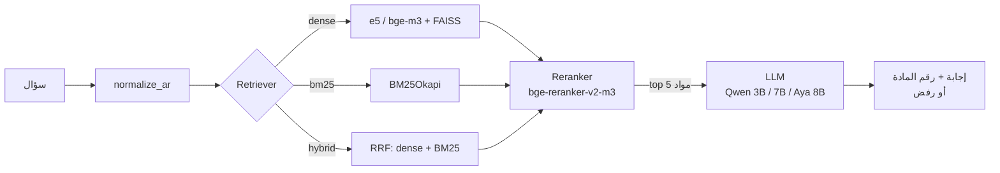

# Egyptian Personal Status RAG

نظام **RAG** بيجاوب على أسئلة الناس في **قوانين الأحوال الشخصية المصرية** (نفقة، حضانة، رؤية، طلاق، خلع، محاكم الأسرة...) من نصوص القانون نفسها، وبيذكر **رقم المادة** مع كل إجابة، وبيرفض يجاوب لو الإجابة مش موجودة في النصوص.

الهدف مش بس نبني النظام، لكن **نقارن بين أكتر من architecture** (embedders، BM25 vs dense vs hybrid، reranker، وموديلات LLM مختلفة) ونقيس كل واحدة بأرقام على test set حقيقي.

---

## الـ Pipeline



الـ reranker اختياري حسب الـ config.

## الـ Architectures اللي بنقارنها

| Config | Embedder | Retriever | Reranker | LLM |
|---|---|---|---|---|
| `arch1` | e5 | dense | — | qwen3b |
| `arch1_bge` | bge-m3 | dense | — | qwen3b |
| `arch2` | bge-m3 | dense | — | qwen7b |
| `arch3_no_rr` | bge-m3 | hybrid | — | aya8b |
| `arch3` | bge-m3 | hybrid | bge | aya8b |

متعرّفين في [`demo/configs.py`](demo/configs.py).

## المقاييس (Task 7)

`recall@5` · `mrr` · `citation_acc` · `refusal_acc` · `avg_seconds` · `peak_gpu_mb` + مراجعة يدوية (`manual_correct`, `manual_faithful`) على 20 سؤال لكل config.

---

## حالة المشروع

| Task | الوصف | المسؤول | الحالة |
|---|---|---|---|
| [T1](demo/tasks/Task1-Data-and-Chunks.md) | استخراج النصوص وتقسيمها مادة مادة + `normalize_ar` | @yousefJooX | ✅ اتعمل merge — 188 مادة |
| [T2](demo/tasks/Task2-Test-Set.md) | Test set (30–40 سؤال + إجابات مرجعية) | @mariasamir173-tech | ✅ 35 سؤال (11 بألفاظ المادة، 9 بالعامية، 5 متعددة المواد، 10 خارج الموضوع) — محتاج review من حد تاني |
| [T3](demo/tasks/Task3-Dense-Retrieval.md) | Embedders (e5, bge-m3) + FAISS dense retriever | @yousefJooX | ✅ اتعمل merge |
| [T4](demo/tasks/Task4-BM25-and-Hybrid.md) | BM25 + Hybrid (RRF) | @marwan149 | ✅ في `main` |
| [T5](demo/tasks/Task5-Reranker-and-Runner.md) | Reranker + registry + configs + runner | @KareemAlwam | ✅ في `main` |
| [T6](demo/tasks/Task6-LLM.md) | LLMs (Qwen 3B / 7B, Aya 8B) + parsing الـ citations | @hm136101-png | ✅ Qwen 3B و 7B اتجربوا على Kaggle + Qwen3-8B إضافي — Aya مستني صلاحية HuggingFace |
| [T7](demo/tasks/Task7-Evaluation.md) | `evaluate.py` + المقاييس + التحليل | — | ⬜ لسه ما بدأش |

### النتايج (Kaggle T4)

أحدث أرقام لكل التجارب في [`demo/results/kaggle/`](demo/results/kaggle/README.md)، وطريقة التشغيل في [`demo/kaggle/`](demo/kaggle/README.md).

---

## المصادر (`raw/`)

| الملف | إيه |
|---|---|
| `raw/official/law_1_2000_gazette.pdf` | القانون 1/2000 – الجريدة الرسمية ع4 مكرر 29/1/2000 |
| `raw/official/law_10_2004_gazette.pdf` | القانون 10/2004 محاكم الأسرة – الجريدة الرسمية ع12 تابع (أ) 18/3/2004 |
| `raw/official/law_25_1920_original_gazette.pdf` | 25/1920 النص الأصلي – الوقائع المصرية ع61 15/7/1920 |
| `raw/official/decree_1926_amend_25_1920_gazette.pdf` | مرسوم 1926 بتعديل 25/1920 – الوقائع المصرية ع54 7/6/1926 |
| `raw/official/law_25_1929_original_gazette.pdf` | 25/1929 النص الأصلي – الوقائع المصرية ع27 25/3/1929 |
| `raw/official/law_176_2020_gazette.pdf` | القانون 176/2020 (م47 من 1/2000) – الجريدة الرسمية ع36 مكرر 5/9/2020 |
| `raw/official/scc_113_26_2006_ruling.pdf` | حكم الدستورية 113/26ق (إثبات الطلاق) |
| `raw/secondary/personal_status_laws_compilation.pdf` | تجميع 25/1920 و25/1929 بعد التعديلات (OCR) — **ده مصدر الـ chunks** |
| `raw/secondary/personal_status_laws_compilation_2003.doc` | تجميع Word 2003 (المواريث، الوصية، الولاية على المال، قرارات 2000) |
| `raw/secondary/ashraf_kamal_encyclopedia/` | موسوعة الأحوال الشخصية – أشرف مصطفى كمال (4 أجزاء) |
| `raw/secondary/ncw_personal_status_guide_2021.pdf` | دليل المجلس القومي للمرأة 2021 |
| `raw/secondary/penal_code_2003.pdf` | قانون العقوبات (طبعة 2003) |
| `raw/secondary/case_reference_10_rulings.pdf` | مرجع 10 أحكام |
| `raw/draft_2026/family_law_draft_2026_with_memo.pdf` | مشروع قانون الأسرة 2026 + المذكرة الإيضاحية (217 ص) |

### الـ chunks (`data/chunks.json`)

188 مادة، كل مادة chunk لوحدها:

| القانون / القرار | عدد المواد |
|---|---|
| القانون 1 لسنة 2000 | 79 |
| القانون 25 لسنة 1929 | 32 |
| قرار وزير العدل 1088 لسنة 2000 | 23 |
| القانون 10 لسنة 2004 (محاكم الأسرة) | 15 |
| القانون 25 لسنة 1920 | 13 |
| قرار وزير العدل 1089 لسنة 2000 | 12 |
| قرار وزير العدل 1087 لسنة 2000 | 9 |
| قرار وزير العدل 1090 لسنة 2000 | 3 |
| قرار وزير العدل 1086 لسنة 2000 | 2 |

---

## الـ Structure

```
.
├── raw/                 المصادر الأصلية (PDF / DOC)
├── chunking/            Task 1: تقسيم النص لمواد → data/chunks.json
├── data/
│   ├── chunks.json      الـ 188 مادة (نسخة واحدة بس، الكل بيقرا منها)
│   └── check_chunks.py  validation للـ chunks
├── utils.py             normalize_ar
└── demo/                الـ RAG pipeline
    ├── blocks/          embedders, dense, bm25, hybrid, rerankers, llms
    ├── data/
    │   ├── test_set.json   Task 2
    │   └── index/          cache للـ embeddings والـ indexes (مش في git)
    ├── configs.py       الـ architectures
    ├── registry.py      بيبني الـ blocks من الـ config
    ├── run.py           بيشغّل config على الـ test set
    ├── check_dense.py   اختبارات Task 3
    ├── tasks/           الـ specs بتاعة الـ 7 tasks
    └── results/         مخرجات run.py و evaluate.py (مش في git)
```

كل block ليه interface ثابت، فكل task بيستبدل الـ stub بتاعه من غير ما يلمس الباقي:

```python
Embedder(name).encode(texts, is_query) -> np.ndarray
DenseRetriever(chunks, embedder).search(question, k) -> list[dict]
BM25Retriever(chunks).search(question, k) -> list[dict]
HybridRetriever(dense, bm25).search(question, k) -> list[dict]
Reranker(chunks).rerank(question, hits, k) -> list[dict]
LLM(name).generate(question, chunks) -> dict
```

---

## التشغيل

بنستخدم [uv](https://docs.astral.sh/uv/) (Python 3.11–3.12):

```bash
uv sync
cd demo
uv run python check_dense.py                 # اختبارات Task 3 (e5 + bge)
uv run python run.py arch1 --retrieval-only  # retrieval بس
uv run python run.py arch3                   # الـ pipeline كامل
```

المخرجات بتتكتب في `demo/results/{config}_retrieval.json` و`_answers.json` و`_cost.json`.

---

## طريقة الشغل في التيم

1. **ماحدش يعمل push على `main` مباشرة.** اعمل branch باسم واضح (`feat/t4-bm25`):
   ```bash
   git checkout -b feat/t4-bm25
   ```
2. عدّل الملف بتاعك **في مكانه** (مثلاً `demo/blocks/bm25.py`)، وماترفعش ملفات من الموقع في الـ root.
3. **شغّل الكود وجرّبه** قبل الـ push، واتأكد إنه بيحقق قسم *Done when* في الـ spec بتاعك.
4. افتح **Pull Request** على `main`، واكتب فيه عملت إيه ونتيجة الاختبار.
5. حد تاني من التيم يراجع، وبعدين نعمل merge.
6. اتأكد إن إيميل git عندك هو نفس إيميل حساب GitHub، عشان شغلك يظهر في الـ Contributors:
   ```bash
   git config --global user.email "your-github-email@example.com"
   ```
